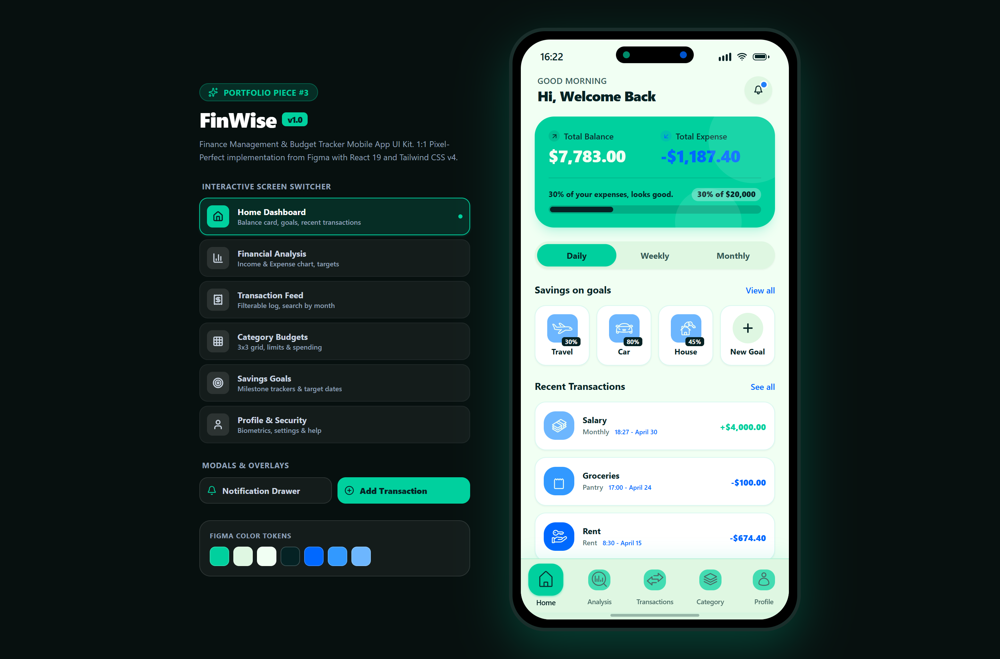
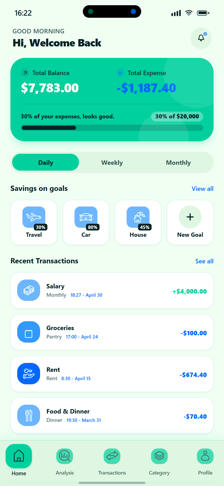
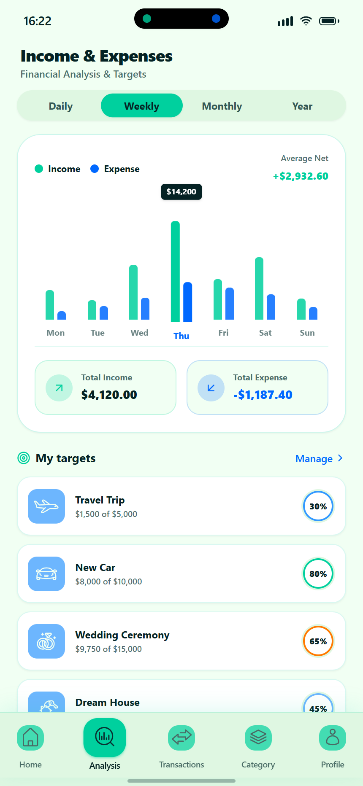
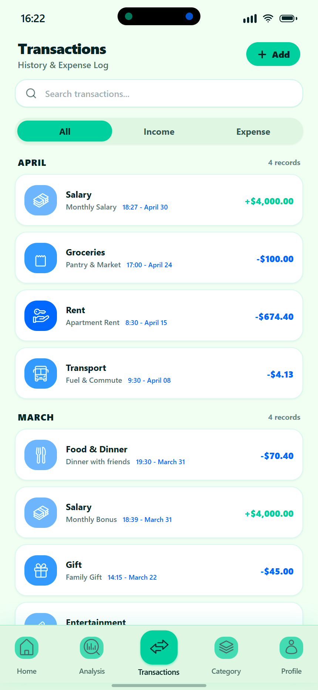
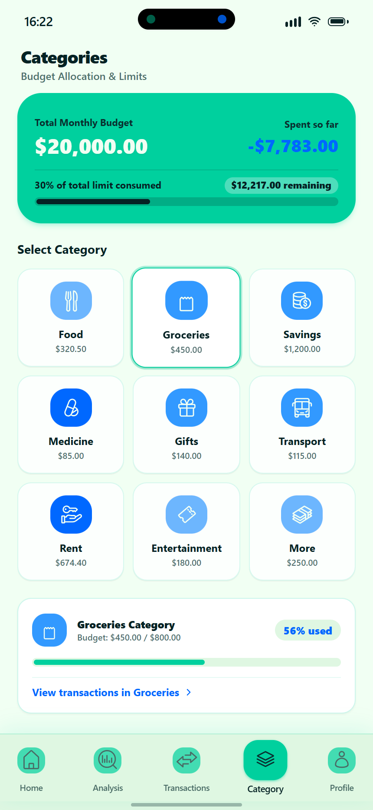
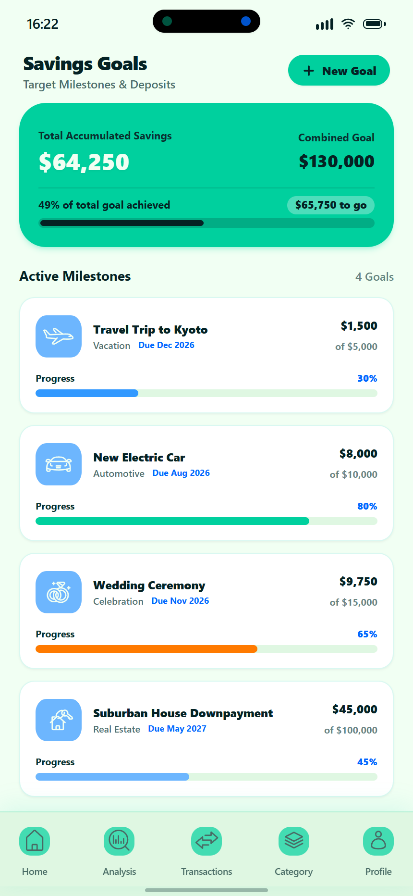
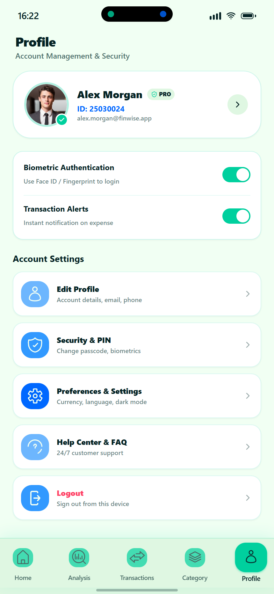
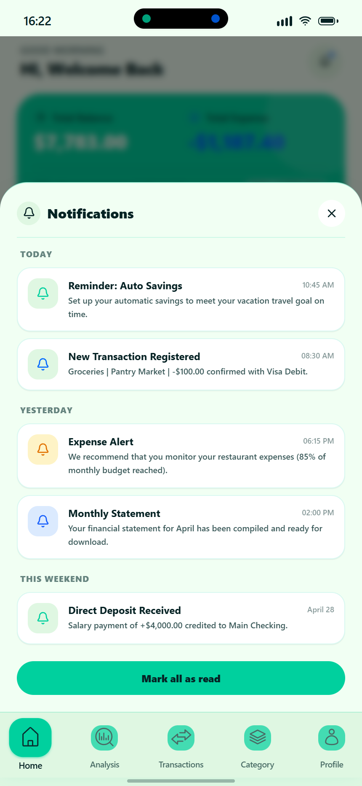

# 💰 FinWise — Modern Finance & Budget Tracker Mobile App

> **International Portfolio Showcase #3**  
> 1:1 Pixel-Perfect Implementation of the **FinWise Mobile Finance & Budget Tracker UI Kit** built with **React 19**, **Vite**, and **Tailwind CSS v4**.



[](https://react.dev/)
[](https://tailwindcss.com/)
[](https://vitejs.dev/)
[](https://opensource.org/licenses/MIT)

---

## 📱 Interactive Multi-Screen Experience

This application features an interactive **Device Frame Simulator** on desktop and operates as a seamless **full-screen native web app** on mobile devices.

| 🏠 Home Dashboard | 📊 Income & Expenses Analysis | 💳 Transactions Feed |
| :---: | :---: | :---: |
|  |  |  |

| 📂 Category Budgets | 🎯 Savings Goals | 👤 Profile & Security |
| :---: | :---: | :---: |
|  |  |  |

| 🔔 Notification Drawer | ➕ Add Transaction Modal |
| :---: | :---: |
|  |  |

---

## 🌟 Key Features

1. **Dashboard (Figma Node `7033:352`)**:
   - Personalized greeting header with live unread notification badge.
   - Signature Mint Green (`#00D09E`) balance card displaying `$7,783.00` total balance, `-$1,187.40` total expenses, and an active `30%` budget consumption bar.
   - Filter switch (Daily / Weekly / Monthly).
   - "Savings on goals" preview circles (Travel, Car, House, + New Goal).
   - Recent Transactions feed with direct routing.

2. **Income & Expenses Analysis (Figma Node `7033:781`)**:
   - Filter pills (Daily / Weekly / Monthly / Year).
   - Interactive comparative bar chart comparing Income (`#00D09E`) vs Expense (`#0068FF`) across days (Mon - Sun).
   - Summary cards with net averages.
   - "My targets" section with progress rings.

3. **Transaction Feed (Figma Node `7035:978` & `7033:2595`)**:
   - Instant search input across transaction names and categories.
   - Segmented filter switch (All / Income / Expense).
   - Grouped chronological logs by month (April, March).
   - Itemized amounts, categories, and timestamps.

4. **Category Budgets (Figma Node `7035:4`)**:
   - Total monthly budget limit banner (`$20,000.00`).
   - 3x3 interactive category grid: Food, Groceries, Savings, Medicine, Gifts, Transport, Rent, Entertainment, More.
   - Dynamic budget consumption meter per category.

5. **Savings Goals (Figma Node `7064:2811`)**:
   - Milestone progress tracker cards for Travel, Electric Car, Wedding, and Suburban House.
   - Target amounts, current balances, and completion percentages.

6. **Profile & Security (Figma Node `7020:3844`)**:
   - User identity card with avatar and member ID badge.
   - Interactive Biometric Authentication (Face ID / Touch ID) switch.
   - Transaction alerts toggle.
   - Settings, security, help center, and logout options.

7. **Notification Drawer & Quick Add Modal (Figma Nodes `7039:187` & `7077:771`)**:
   - Bottom sheet notification center with categorized alerts.
   - Complete transaction creation form with instant feedback.

---

## 🎨 Design Tokens & Specs

Extracted directly from the official Figma Design System (`1:422`):
- **Caribbean Green (Primary Brand)**: `#00D09E`
- **Honeydew (Canvas / Light BG)**: `#F1FFF3`
- **Light Green (Pill / Cards)**: `#DFF7E2`
- **Fence Green (Dark Text)**: `#052224`
- **Cyprus (Muted Dark)**: `#0E3E3E`
- **Void (Chassis)**: `#031314`
- **Ocean Blue (Accent)**: `#0068FF`
- **Vivid Blue**: `#3299FF`
- **Light Blue**: `#6DB6FE`
- **Typography**: Plus Jakarta Sans & Inter

---

## 🚀 Getting Started

### Prerequisites
- Node.js (v18+)
- npm or yarn

### Installation
```bash
# Clone the repository
git clone https://github.com/lxlnimalxl/finwise-mobile-banking-app.git

# Enter project directory
cd finwise-mobile-banking-app

# Install dependencies
npm install

# Start development server
npm run dev
```

### Production Build
```bash
npm run build
npm run preview
```

---

## 📄 License
Released under the [MIT License](./LICENSE).
